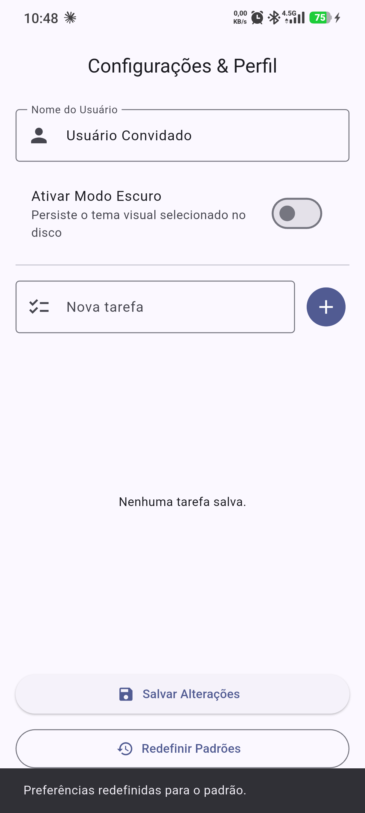

# PDM I — Aula 12: Persistência Local com SharedPreferences

Aplicativo Flutter que persiste preferências do usuário (nome, modo escuro, data do último acesso e uma lista de tarefas) no armazenamento do dispositivo usando pares chave-valor do pacote `shared_preferences`. Toda a lógica de acesso fica encapsulada em um `PreferencesService` reutilizável.

**Disciplina:** Programação para Dispositivos Móveis I — Prof. Diego Menegassi — 2026/2

## Conceitos aplicados

| Conceito | Implementação |
|---|---|
| Armazenamento chave-valor | `shared_preferences` com chaves isoladas no `PreferencesService` |
| Acesso assíncrono | `SharedPreferences.getInstance()` em cada método do serviço |
| Gravação de dados | `prefs.setString()` / `prefs.setBool()` |
| Leitura e inicialização | Tema lido no `main()` antes do `runApp`; nome e tarefas carregados no `initState()` |
| Reatividade do tema | Callback `onTemaAlterado` atualiza o `themeMode` do `MaterialApp` na hora |

## Desafios implementados

- **Básico — Data do Último Acesso:** a cada abertura o app grava `DateTime.now().toString()` em `key_ultimo_acesso` e exibe o acesso anterior no rodapé.
- **Intermediário — Redefinir Padrões:** botão com confirmação que chama `service.limparTudo()` e restaura nome, tema, tarefas e rodapé para os valores iniciais.
- **Avançado — Lista JSON em String:** lista de tarefas (`List<Map>`) salva com `jsonEncode` e lida com `jsonDecode`, com opções de adicionar, concluir e remover.

## Capturas de tela

| Primeiro acesso | Perfil e tarefas | Modo escuro salvo |
|:---:|:---:|:---:|
|  |  |  |

| App reaberto (dados persistidos) | Redefinir padrões | Após redefinir |
|:---:|:---:|:---:|
|  |  |  |

## Estrutura

```
lib/
├── main.dart
├── services/preferences_service.dart
└── screens/configuracoes_screen.dart
test/
└── widget_test.dart
```

## Como executar

```bash
flutter pub get
flutter run
flutter test
```
